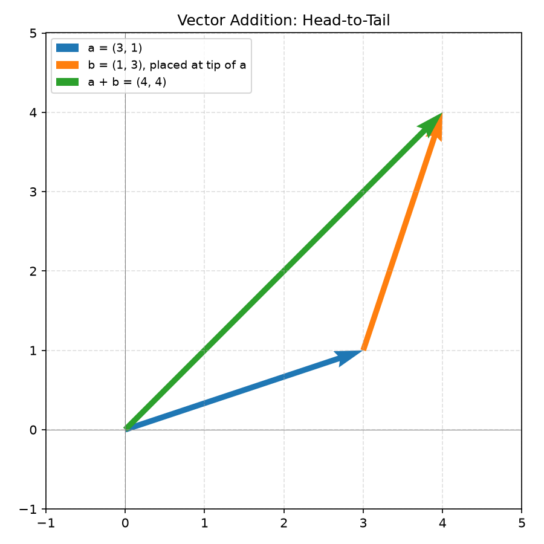
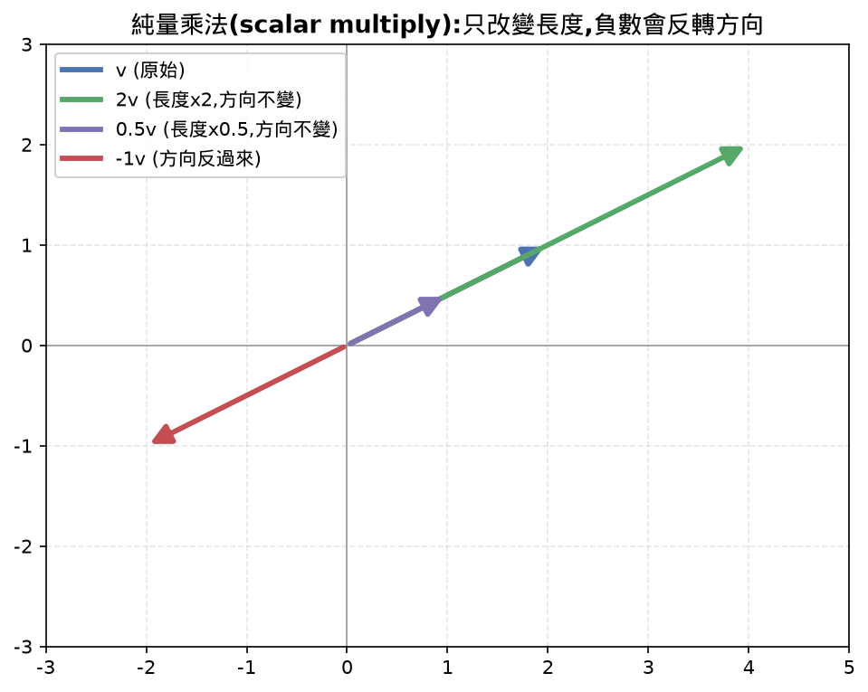

# Linear Algebra Intuition

建立向量與矩陣的基本直覺。向量代表方向與長度，矩陣乘向量本質上是每一列各自跟輸入向量做內積。

## 名詞
| 名詞 | 意思 |
|---|---|
| Vector（向量） | 一串數字，同時代表方向跟長度，可以想成空間裡一個從原點出發的箭頭 |
| Vector Addition / Subtraction（向量加法/減法） | 頭尾相接法，終點就是相加後的向量;減法代表「從一個點走到另一個點」的方向跟距離 |
| Scalar Multiplication（純量乘法） | 向量乘上一個數字，只改變長度不改變方向，數字是負的話方向反過來 |
| Dot Product（內積） | 兩個向量對應位置的數字相乘再全部加總，量兩個向量指向同一方向的程度:完全同方向最大、垂直是0、完全反方向是負的最大值 |
| Magnitude（長度） | 向量自己跟自己做內積再開根號，畢氏定理的推廣(各維度平方和開根號) |
| Cosine Similarity（餘弦相似度） | dot product除以兩個向量長度的乘積，拿掉長度影響只留方向像不像，範圍固定-1到1 |
| Matrix（矩陣） | 很多個向量疊在一起，一列就是一個向量;矩陣乘向量=每一列分別跟輸入向量做一次內積，收集成新向量 |
| Embedding（嵌入） | 代表某樣東西(文字/圖片/使用者)意義的一個向量，本質上就是一般向量，差別在於經過學習後意義相近的東西距離也會相近 |
| Linear Independence（線性獨立） | 一組向量裡，沒有任何一個能用其他向量的線性組合表示出來，代表每個向量都帶來「新的」方向資訊 |
| Rank（秩） | 矩陣裡線性獨立的行(或列)的個數，代表這個矩陣實際能覆蓋到的維度數 |
| Projection（投影） | 一個向量在另一個向量方向上的分量，可以想成物體照光後在某個方向上的「影子」長度 |
| Basis（基底） | 一組數量最少、彼此線性獨立、且能張成整個空間的向量，相當於這個空間的座標軸 |
| Orthonormal（單位正交） | 彼此互相垂直、且長度都是1的一組向量，常見於旋轉矩陣跟QR分解裡 |




## 重點
| 概念 | 我的理解 |
|---|---|
| Vector | 一串數字，同時代表方向與長度。加減法是箭頭頭尾相接，純量乘法只改變長度。 |
| Dot Product | 兩個向量對應位置相乘再加總，量兩個向量指向同一方向的程度。完全同方向最大、垂直為 0、反方向為負最大值。 |
| Cosine Similarity | 內積除以兩個向量長度的乘積，去除長度干擾只保留方向相似度，範圍在 -1 到 1。 |
| Matrix Multiply | 矩陣乘向量就是矩陣的每一列分別跟輸入向量做一次內積，收集成新向量。 |
| Rank 與 LoRA | rank 是一組向量裡線性獨立的個數，代表矩陣撐起的有效維度。LoRA 利用權重更新量 rank 通常很低的特性，將大矩陣拆成兩個小矩陣相乘來省參數。 |

## 公式／程式
```python
def dot(self, other):
    return sum(a * b for a, b in zip(self.components, other.components))

def magnitude(self):
    return sum(x**2 for x in self.components) ** 0.5

def cosine_similarity(self, other):
    return self.dot(other) / (self.magnitude() * other.magnitude())
```

```text
內積: a·b = a1*b1 + a2*b2 + ...
餘弦相似度: cos_sim(a, b) = (a·b) / (|a| * |b|)
矩陣乘向量: 輸出第 i 個數字 = 矩陣第 i 列 · 輸入向量
LoRA 低秩分解: ΔW = B @ A，B 為 (m, r)、A 為 (r, n)，r 遠小於 m 和 n
```

## 卡住的地方
- 容易誤以為內積數值越大代表越像，但內積會被向量長度放大，要看 cosine similarity 才能單純比較方向。
- 物件導向語法（class、self、運算子重載如 `__matmul__`）一開始比較不習慣。
- projection 與 Gram-Schmidt 只有跑過計算，幾何直覺還需要加強；rank 與 basis 的計算流程還沒完全想通。
