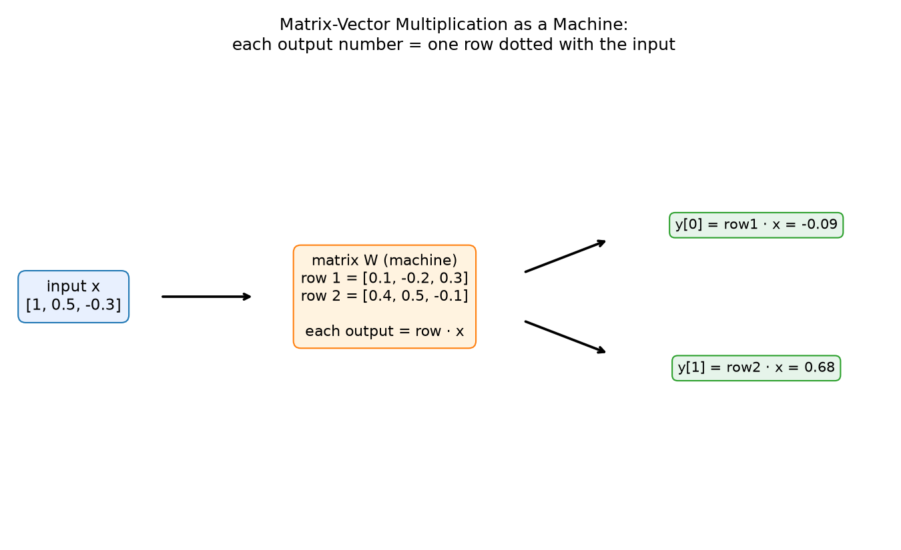
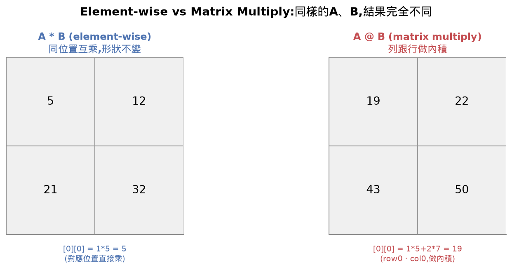

# Vectors, Matrices & Operations

將矩陣理解為把 n 維向量映射到 m 維向量的轉換機器。搞懂逐項相乘與矩陣乘法的差異，以及神經網路單層計算與廣播機制。

## 名詞
| 名詞 | 意思 |
|---|---|
| Vector（向量） | 一串有順序的數字，在AI裡可以想成高維空間裡的一個點 |
| Matrix（矩陣 (m×n)） | 一台機器:吃n維向量，吐出m維向量，每一列對應輸出的其中一個數字，是「輸入向量」跟「這一列」做內積算出來的 |
| Element-wise Multiply（逐項相乘） | 兩個形狀完全一樣的東西，同位置的數字互乘，numpy用`*`，結果形狀不變 |
| Matrix Multiply（矩陣乘法） | 一列跟一行做內積，不是同位置相乘，numpy用`@`，形狀規則(m,n)@(n,p)=(m,p)，中間的n要對上 |
| Transpose（轉置） | 把矩陣的行跟列互換，(m,n)轉置後變成(n,m)，原本[i][j]轉置後在[j][i] |
| Determinant（行列式） | 只有正方形矩陣才有，代表這個矩陣把空間放大/縮小幾倍;是0代表空間被壓扁、資訊永久遺失、沒辦法逆推 |
| Inverse（逆矩陣） | 「反著做」的矩陣，A把X搬到Y、A⁻¹把Y搬回X，只有determinant≠0才存在，因為壓扁遺失的資訊沒有回頭路 |
| Identity Matrix（單位矩陣） | 對角線是1、其餘是0，任何(尺寸相容的)矩陣乘上它都不變，是矩陣世界的「1」，A乘上A⁻¹結果就是它 |
| ReLU Layer (`relu(W @ x + b)`)（神經網路一層） | 深度學習裡最常重複的一行，W決定輸入怎麼組合、b是每個輸出的偏移量、relu把負數砍成0;輸出維度由W的形狀決定 |
| Broadcasting（廣播） | 形狀不完全一樣的陣列做運算時，numpy自動把size是1的維度複製延伸去對齊另一邊，對不齊才報錯，常見於一次丟一整批(batch)資料時bias自動複製batch次 |




## 重點
| 概念 | 我的理解 |
|---|---|
| Element-wise vs Matmul | `*` 是逐項相乘，兩邊形狀相同或可廣播，結果形狀不變；`@` 是矩陣乘法，列對行做內積，`(m, n) @ (n, p) = (m, p)`。 |
| Determinant | 行列式代表矩陣將空間體積放大或縮小的倍率。若為 0 表示空間被壓扁、資訊遺失，無法逆推。 |
| Inverse | 逆矩陣是將變換復原的矩陣，只有 determinant != 0 時才存在。 |
| ReLU Layer | `relu(W @ x + b)` 是神經網路一層的基礎結構。W 負責特徵線性組合，b 提供偏移量，ReLU 引入非線性。 |
| Broadcasting | 當兩個陣列形狀不同但某維度為 1 或不存在時，NumPy 自動沿該維度複製延伸以對齊形狀，常見於批次資料加 bias。 |

## 公式／程式
```python
# 神經網路一層
output = np.maximum(0, weights @ inputs + bias)
```

```text
矩陣乘法形狀規則: (m, n) @ (n, p) = (m, p)
逆矩陣存在條件: determinant != 0
ReLU 函數: relu(x) = max(0, x)
```

```python
# 純 Python list 與 NumPy array 行為差異
[1, 2] + [3, 4]                      # 串接 -> [1, 2, 3, 4]
np.array([1, 2]) + np.array([3, 4])  # 逐項相加 -> [4, 6]
```

## 卡住的地方
- Broadcasting 一開始只記住抽象維度規則，不知道實際用途；後來透過批次資料（batch）加偏置（bias）的情境才想通為什麼需要它。
- 容易把 `*` 誤當成矩陣乘法，但在 NumPy 裡必須用 `@`；混用若剛好形狀相同不會報錯，但會默默算出錯誤數值。
- Python 原生 list 的 `+` 是串接，不是數學上的向量相加，不能直接拿來做陣列運算。
