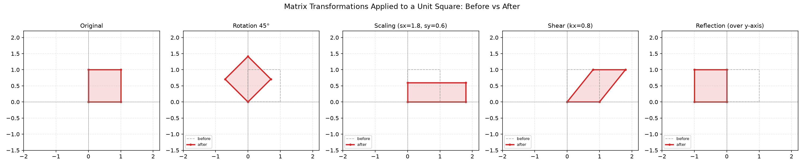
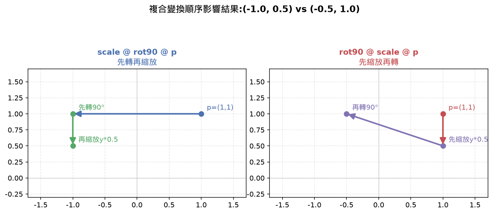

# Matrix Transformations

學習空間變換矩陣的幾何意義（旋轉、縮放、切斜、鏡射），以及特徵值與特徵向量的數學推導與應用。

## 名詞
| 名詞 | 意思 |
|---|---|
| Rotation Matrix（旋轉矩陣） | `[[cosθ,-sinθ],[sinθ,cosθ]]`，繞原點轉θ角度，距離角度都不變，det恆=1 |
| Scaling Matrix（縮放矩陣） | `[[sx,0],[0,sy]]`，對角線放各軸的縮放倍數，x/y各自獨立，det=sx*sy |
| Shearing Matrix（切斜矩陣） | `[[1,k],[0,1]]`(切x)或`[[1,0],[k,1]]`(切y),k放在哪個位置誰就被另一軸拖著偏移，單向切斜面積不變、det=1(兩個方向都切時 det=1-kx·ky) |
| Reflection（鏡射矩陣） | `[[-1,0],[0,1]]`(對y軸)或`[[1,0],[0,-1]]`(對x軸)，哪個軸不動就放1、另一個放-1,det恆=-1 |
| Composition（複合變換） | `B @ A @ 點`=先套用A、再套用B，矩陣乘法從右邊先算，順序不能換，矩陣乘法沒有交換律 |
| Eigenvector（特徵向量） | 矩陣乘上它，仍在同一條直線上(可能反向)、只被拉長縮短的特殊向量，定義規定必須非零 |
| Eigenvalue（特徵值） | eigenvector被拉長縮短的倍數，可以是負數(方向翻面)或複數(旋轉矩陣的情況) |
| Characteristic Equation（特徵方程式） | `det(A - λI) = 0`，求eigenvalue的方程式，2x2矩陣展開後是`λ²-trace·λ+det=0` |
| Eigendecomposition（特徵分解） | `A = V @ D @ V⁻¹`，把矩陣拆解成:換到eigenvector座標系→沿各軸用對應eigenvalue伸縮→換回來 |
| Singular Matrix（奇異矩陣） | det=0的矩陣，存在非零向量被壓成零向量，空間被壓扁、資訊遺失、不可逆 |
| Determinant（行列式） | \|det\|=變換把面積/體積放大縮小的倍數，旋轉恆=1、單向切斜=1(面積不變)、鏡射恆=-1(面積不變但翻面)、縮放=sx*sy |




## 重點
| 概念 | 我的理解 |
|---|---|
| Transformation Matrices | 旋轉、縮放、切斜、鏡射是操作空間的變換矩陣。旋轉使用三角函數且行列式為 1，縮放放對角線，單向切斜面積不變，鏡射行列式為 -1。 |
| Composition | 複合變換 `B @ A @ x` 代表先套用 A 再套用 B，矩陣乘法不具交換律，乘法順序由右往左計算。 |
| Eigenvector & Eigenvalue | 矩陣作用後仍在同一條直線上(可能反向)、只被拉伸或縮短的非零向量為特徵向量，拉伸倍率為特徵值。滿足 `A @ v = λ * v`。 |
| Characteristic Equation | 由 `(A - λI)v = 0` 推導出 `det(A - λI) = 0`，求解多項式根即可得到特徵值。 |
| RNN Stability & PCA | RNN 權重矩陣特徵值絕對值大於 1 導致梯度爆炸，小於 1 導致梯度消失；PCA 挑選共變異數矩陣最大特徵值對應的特徵向量作為第一主成分。 |

## 公式／程式
```text
旋轉矩陣: [[cos(θ), -sin(θ)], [sin(θ), cos(θ)]]
縮放矩陣: [[sx, 0], [0, sy]]
特徵方程式: det(A - λI) = 0
2x2 特徵多項式: λ² - trace(A)·λ + det(A) = 0
特徵分解: A = V @ D @ V⁻¹
```

```python
# 特徵值驗證概念
# A @ v == lambda_val * v
Av = A @ v
lv = lambda_val * v
```

## 卡住的地方
- 複合變換的先後順序容易直覺搞混，矩陣乘法由右往左套用，先旋轉再縮放與先縮放再旋轉的座標結果完全不同。
- 容易誤以為所有方陣都能做實數特徵分解，實際上旋轉矩陣的特徵值是複數，且存在缺陷矩陣無法湊足獨立特徵向量。
- NumPy 計算回傳的特徵向量矩陣中，每一欄（column）才是一個特徵向量，跟平常一列代表一筆資料的習慣相反。
