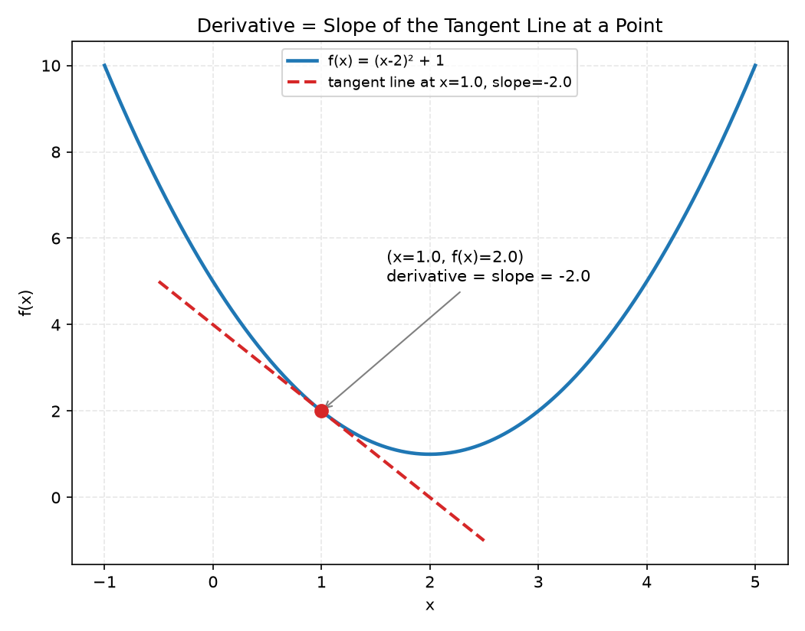
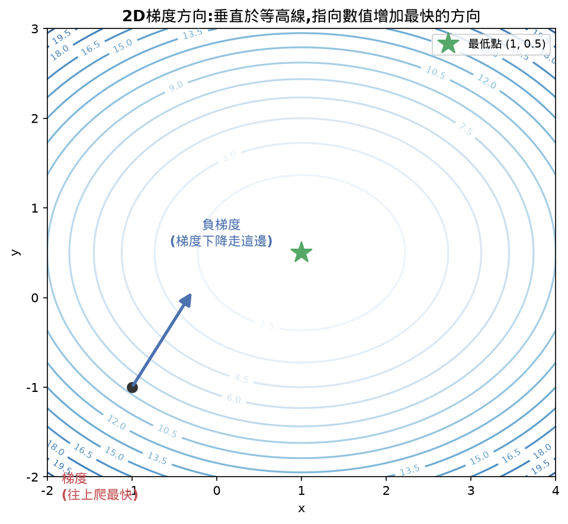

# Calculus for ML

學習機器學習中最關鍵的微積分基礎。掌握導數、偏導數、梯度與梯度下降更新規則，並理解 Hessian 矩陣在判斷鞍點中的角色。

## 名詞
| 名詞 | 意思 |
|---|---|
| Derivative（導數） | 函數在某點的變化速度/斜率，幾何上是切線斜率;x稍微變動一點，y大概變多少 |
| Partial Derivative（偏導數） | 只動一個變數，其他變數固定不動，算出的變化率;神經網路裡每個權重各自的偏導數，分開算才知道各自該怎麼調 |
| Gradient（梯度） | 把每個變數的偏導數收集成一個向量，指向「往上爬最快」的方向;要下降就走它的反方向 |
| Gradient Descent（梯度下降） | 更新規則:新值=舊值−學習率×梯度，只需要一階導數，重複很多次就能逼近函數最低點 |
| Learning Rate（學習率） | 控制每一步跨多大，太大會讓局部線性逼近失效、甚至發散;太小收斂很慢 |
| Numerical Derivative（數值法） | 動一點點、看輸出差多少，逼近導數定義本身，`[f(x+h)-f(x-h)]/(2h)`，任何函數都能用，但是逼近值有極小誤差 |
| Analytical Derivative（解析法） | 手推公式，精確算出導數，快、準，但要先會推導這個函數的公式 |
| Hessian（Hessian矩陣） | 二階偏導數湊成的矩陣，告訴你「地形彎的程度」;eigenvalue全正=局部極小值，全負=局部極大值，有正有負=鞍點(梯度為0，但沿某些方向是最低、沿另一些方向是最高) |
| Saddle Point（鞍點） | 梯度=0但不是極值的地方，沿某些方向是最低、沿另一些方向是最高(像馬鞍)，靠Hessian的eigenvalue判斷 |
| Newton's Method（牛頓法） | 用梯度+Hessian一起算更新方向，對二次函數理論上一步就到谷底(一般函數不保證)，但Hessian太大(N²)，深度學習用不起 |
| Taylor Series（泰勒展開） | 用多項式局部逼近任何函數，一階近似=梯度下降在做的事;二階近似=牛頓法在做的事 |
| Linear Regression（線性迴歸） | y=wx+b，用梯度下降訓練w、b,predict→算loss→算梯度→更新，是所有神經網路訓練迴圈的縮影 |
| Chain Rule（連鎖律） | 複合函數的導數=各層導數相乘:df/dx = df/dg × dg/dx，反向傳播的數學基礎，一路把每一層的導數乘回去 |
| Jacobian（雅可比矩陣） | 輸入輸出都是向量時，把所有輸出對所有輸入的偏導數排成矩陣，可以想成「向量版的梯度」，描述整個輸出向量怎麼隨輸入向量變化 |
| Backpropagation（反向傳播） | 從輸出往輸入方向，一層一層用連鎖律算梯度，神經網路實際「學習」時用的演算法，本質就是連鎖律的系統化應用 |
| Integral（積分） | 曲線下的面積，是「累積量」，機器學習裡機率分布、期望值、KL散度的定義都要靠積分 |




## 重點
| 概念 | 我的理解 |
|---|---|
| Derivative & Partial Derivative | 導數表示調整變數時輸出的瞬時變化率。偏導數是在固定其他變數下，只變動單一變數時的變化率。 |
| Gradient | 將各變數的偏導數組裝成向量，指向函數上升最快的方向；沿負梯度方向前進即可讓函數值下降。 |
| Gradient Descent | 核心更新規則為 `新值 = 舊值 - 學習率 × 梯度`。學習率過大會發散，過小則收斂緩慢。 |
| Numerical vs Analytical | 數值法透過中央差分逼近，適合驗證梯度；解析法直接透過公式推導計算精確值，效率高且無逼近誤差。 |
| Hessian & Saddle Point | 二階偏導數構成的 Hessian 矩陣反映曲率。特徵值全正為局部極小值，全負為局部極大值，有正有負則為鞍點。 |

## 公式／程式
```text
數值導數 (中央差分): f'(x) ≈ [f(x + h) - f(x - h)] / (2h)
梯度下降更新規則: θ_new = θ_old - lr * grad
線性迴歸梯度: dw = mean(2 * error * x), db = mean(2 * error)
二元 Hessian 矩陣: [[d²f/dx², d²f/dxdy], [d²f/dydx, d²f/dy²]]
牛頓法更新規則: x_new = x_old - (Hessian⁻¹) @ grad
```

```python
# 1D 梯度下降範例
x = 5.0
lr = 0.1
for _ in range(50):
    grad = 2 * x  # f(x) = x^2 的導數
    x -= lr * grad
```

## 卡住的地方
- 容易把「變數維度增加」跟「導數階數提升」混在一起；實際上處理多個變數是一階偏導數組成的向量，而 Hessian 則是對兩兩變數求二階偏導數的矩陣，兩者完全獨立。
- 誤以為牛頓法使用二階曲率資訊就一定比梯度下降更好；其實牛頓法只尋找梯度為 0 的點，可能落入鞍點或局部極大值，且 Hessian 矩陣的運算量隨參數量平方成長，在深度學習中代價過高。
