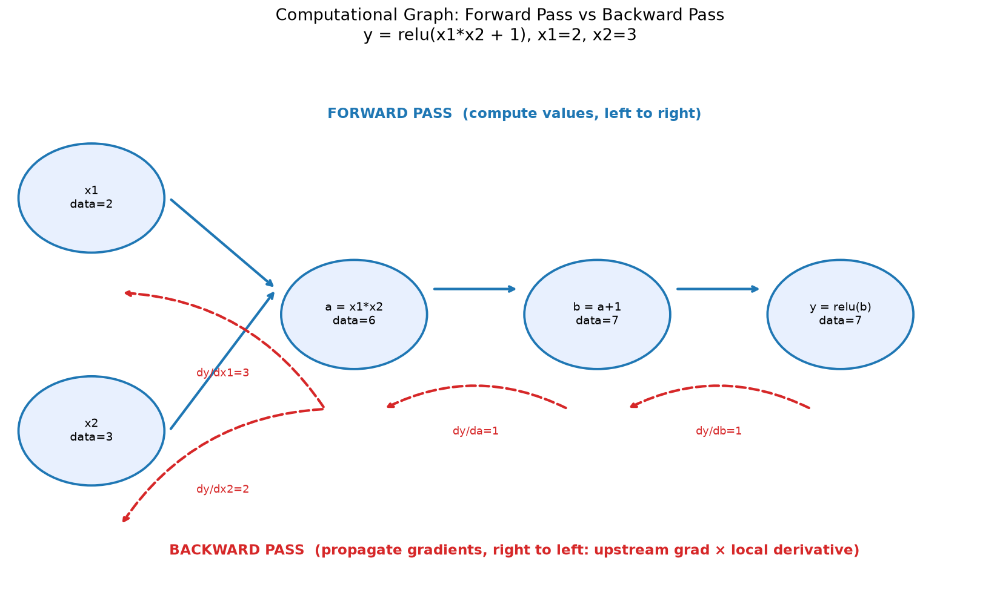
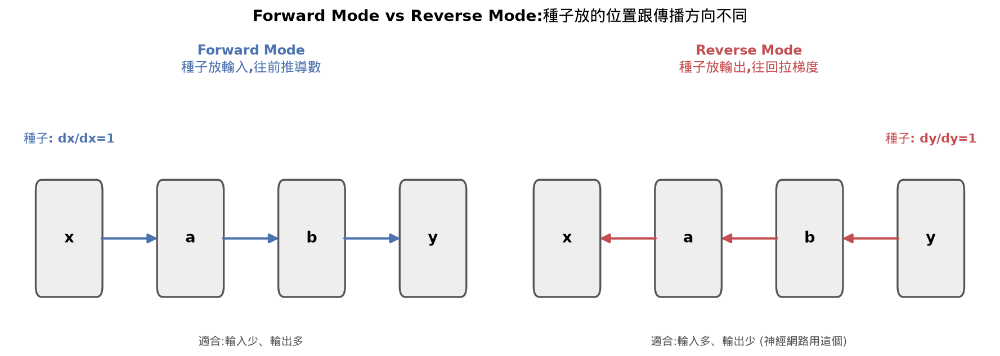

# Chain Rule & Automatic Differentiation

學習反向傳播與自動微分引擎原理。計算圖將複雜運算拆成單步，反向模式透過鏈鎖法則逐站計算「上游梯度 × 局部導數」，一次求出所有參數的梯度。

## 名詞
| 名詞 | 意思 |
|---|---|
| Chain Rule（鏈鎖法則） | 合成函數的導數,等於每一層局部導數連乘 |
| Computational Graph（計算圖） | 把運算拆成節點畫成圖,正向算值、反向算梯度 |
| Local Derivative（局部導數） | 只看單一運算自己的導數,不管前後文 |
| Upstream Gradient（上游梯度） | 從輸出那邊已經傳過來的梯度值 |
| Forward Mode（正向模式） | 種子放輸入,往前推導數,適合輸入少輸出多 |
| Reverse Mode（反向模式） | 種子放輸出,往回拉梯度,適合輸入多輸出少(神經網路用這個) |
| Dual Numbers（對偶數） | 把值跟導數包成一組(值,導數),正向模式的一種實作 |
| Automatic Differentiation（自動微分） | 記錄運算、自動算出精確梯度的系統 |
| Topological Sort（拓撲排序） | 排順序規則:小孩一定排在爸媽前面 |
| Closure（閉包） | 內層函式能記住並使用外層函式的變數,即使外層已結束 |
| Gradient Accumulation（梯度累加） | 同一變數被用在多處時,梯度要加總不能覆蓋 |
| Dynamic Graph（動態圖） | 每次正向傳播都重新蓋一次計算圖(PyTorch風格) |
| Gradient Checking（梯度檢查） | 拿數值法梯度比對autodiff梯度,驗證正確性 |
| Hidden Layer（隱藏層） | 輸入層跟輸出層中間的層,外面看不到它的數值 |
| Neuron（神經元） | 加權總和+偏差,再套激活函數 |
| Layer（層） | 好幾個神經元並排,同時處理同一組輸入 |
| MLP（多層感知器） | 好幾層疊起來的網路 |
| tanh（雙曲正切函數） | 把任何數字壓縮成-1到1之間的S形曲線,激活函數之一 |
| XOR（互斥或） | 兩個輸入不一樣時輸出1,一樣時輸出0 |
| Loss（損失） | 一個數字,代表模型現在預測得多爛 |
| Parameters（參數） | 模型裡所有可以被調整學習的數字(w、b) |




## 重點
| 概念 | 我的理解 |
|---|---|
| Chain Rule | 合成函數的導數等於各層局部導數的連乘。計算圖拆解成單步運算後即可逐層套用。 |
| Local Derivative | 局部運算本身的導數。加法局部導數恆為 1；乘法局部導數為另一個輸入的值；ReLU 在 x > 0 時為 1，否則為 0。 |
| Reverse-mode Autodiff | 起點設在輸出（種子梯度 dy/dy = 1），沿計算圖反向推導。神經網路權重多、損失值只有一個，反向模式遠比正向模式高效。 |
| Topological Sort | 反向傳播前必須對節點進行拓撲排序，確保所有下游依賴節點先計算完畢，避免多路徑匯聚時梯度漏算。 |
| Gradient Accumulation | 當同一個變數在多個運算中被重複引用時，其梯度必須累加（`+=`）而不是覆蓋。 |

## 公式／程式
```text
鏈鎖法則: dy/dx = (dy/du) * (du/dx)
反向傳播核心: 節點梯度 = 上游梯度 * 節點局部導數
種子梯度: dy/dy = 1.0
加法局部導數: 1.0
乘法局部導數: d(a*b)/da = b, d(a*b)/db = a
```

```python
# Value 節點反向傳播與拓撲排序架構
def backward(self):
    topo = []
    visited = set()
    def build_topo(v):
        if v not in visited:
            visited.add(v)
            for child in v._prev:
                build_topo(child)
            topo.append(v)
    build_topo(self)

    self.grad = 1.0
    for v in reversed(topo):
        v._backward()
```

## 卡住的地方
- 容易誤將反向傳播當成正向運算的數學反向操作（例如減法對加法）；實際上正向算的是數值，反向算的是輸出對節點的敏感度，走同一個圖但方向相反。
- 一開始表述反向傳播時容易邏輯打結，後來確立核心原則只有一句：每一站都是「上游梯度 × 該運算的局部導數」，換不同運算只改局部導數公式。
- 拓撲排序遞迴走訪（`build_topo`）確保子節點先於父節點加入清單的順序需要多花時間釐清細節。
