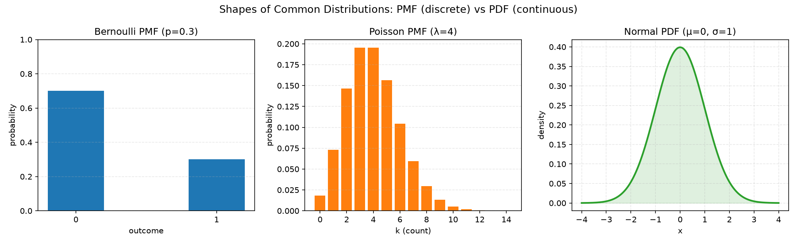
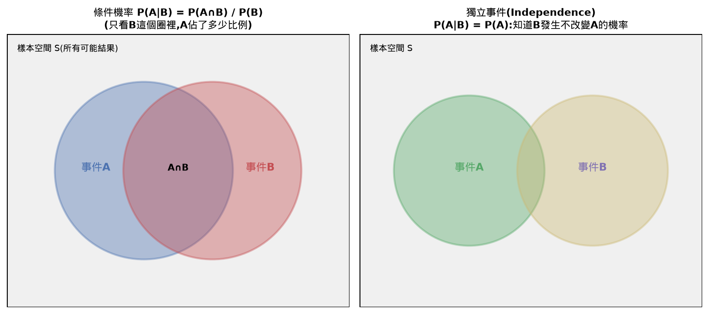

# Probability and Distributions

建立機器學習所需的機率分布直覺。掌握期望值、變異數、中央極限定理，以及分類模型中 Softmax 數值穩定處理與交叉熵損失。

## 名詞
| 名詞 | 意思 |
|---|---|
| Sample space (S)（樣本空間） | 一件事所有可能結果的集合 |
| Event（事件） | 樣本空間裡的一個子集合 |
| PMF (Probability Mass Function)（機率質量函數） | 給離散變數每個結果的確切機率 |
| PDF (Probability Density Function)（機率密度函數） | 給連續變數的密度函數,要積分才能得到機率 |
| Conditional probability（條件機率） | P(A\|B),已知B發生的前提下A發生的機率 |
| Independence（獨立事件） | 知道一件事發生不會改變另一件事發生的機率 |
| Expected value（期望值） | 用機率加權平均後的「平均結果」 |
| Variance（變異數） | 結果離期望值有多分散 |
| Normal distribution（常態分布(高斯分布)） | 鐘形曲線,由平均值跟變異數決定形狀 |
| Central Limit Theorem (CLT)（中央極限定理） | 很多獨立隨機變數的平均值,最後都會趨近常態分布 |
| Joint distribution（聯合分布） | P(X,Y),描述X和Y每一種組合一起發生的機率 |
| Marginal distribution（邊際分布） | P(X)=Σ_y P(X,Y),把另一個變數加總消掉,還原出單一變數的分布 |
| Log probability（對數機率） | 取log後的機率,把連乘變連加,避免數值下溢 |
| Softmax（—） | 把模型的原始分數(logits)轉成合法的機率分布 |
| Logits（—） | 模型softmax之前吐出來的原始分數 |
| Cross-entropy（交叉熵） | 衡量兩個機率分布差多少的損失函數 |
| Sampling（抽樣） | 依照機率分布規則隨機抽出一個值 |




## 重點
| 概念 | 我的理解 |
|---|---|
| PMF vs PDF | 離散變數用 PMF 給出各點確切機率；連續變數用 PDF 表示密度，單點機率為 0，必須對區間積分才是機率，密度本身可大於 1。 |
| Expected Value & Variance | 期望值是機率加權平均；變異數量化資料離散程度，定義式為 `E[(X - μ)²]`，等價於展開式 `E[X²] - (E[X])²`。 |
| CLT | 中央極限定理指出，大量獨立隨機變數的均值在樣本增加時會趨近常態分布。 |
| Softmax 數值穩定 | 每個 logit 先減去最大值再取 exp，在數學上比例不變，但能避免數值過大導致浮點數溢位（overflow）。 |
| Cross-Entropy Loss | 衡量預測分布與真實分布的差異，公式簡化為 `-log(正確類別機率)`；機率越接近 1 損失越小。 |

## 公式／程式
```text
變異數定義: Var(X) = E[(X - μ)²] = E[X²] - (E[X])²
數值穩定 Softmax: softmax(z)_i = exp(z_i - c) / Σ_j exp(z_j - c)，其中 c = max(z)
交叉熵損失: Loss = -log(p_true)
邊際分布: P(X=x) = Σ_y P(X=x, Y=y)
```

```python
# 數值穩定版 softmax
def softmax(logits):
    c = max(logits)
    exp_shifted = [math.exp(z - c) for z in logits]
    total = sum(exp_shifted)
    return [val / total for val in exp_shifted]
```

## 卡住的地方
- 容易誤將 PDF 的縱軸數值當成機率，甚至覺得大於 1 是算錯；其實它是密度，連續變數單點機率為 0，要對區間積分才有意義。
- 若先算 softmax 得到機率再取 log，在機率極小時會被浮點數捨去為 0.0，導致 `log(0)` 變成負無窮引發錯誤；必須用 log-sum-exp 合併計算 log-softmax。
- 連續機率相乘容易產生浮點數下溢（underflow），因此訓練時需全面使用對數機率將相乘轉為相加。
