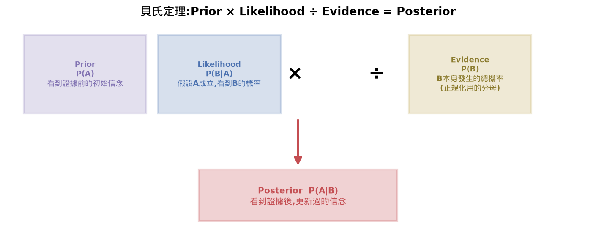
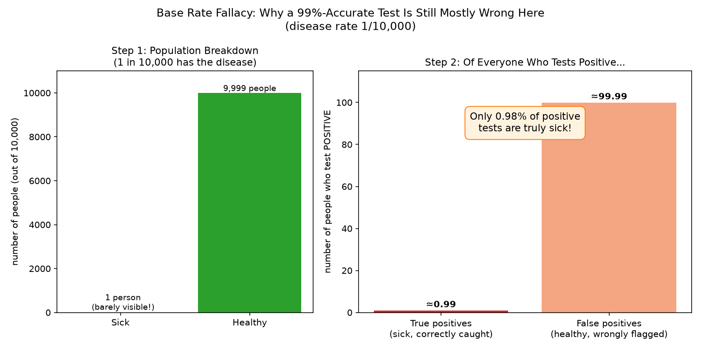

# Bayes' Theorem

學習如何根據新證據更新信念。從條件機率推導貝氏定理，理解基本比率謬誤、樸素貝氏分類器，以及 MAP 估計與 L2 正則化的等價關係。

## 名詞
| 名詞 | 意思 |
|---|---|
| Prior（先驗機率） | 看到證據之前，你對一件事的初始信念 |
| Likelihood（似然） | 如果假設成立，觀察到這個證據的機率有多高 |
| Posterior（後驗機率） | 看到證據之後，更新過的信念 |
| Evidence（證據項） | 證據本身發生的總機率，用來當分母做正規化 |
| Naive Bayes（樸素貝氏） | 假設所有特徵互相獨立的分類器 |
| Laplace smoothing（拉普拉斯平滑） | 給每個計數都加一個小數字，避免機率算出0 |
| MLE (Maximum Likelihood Estimation)（最大似然估計） | 選一組參數，讓「觀察到的資料」發生機率最大，不考慮先驗 |
| MAP (Maximum a Posteriori)（最大後驗估計） | MLE加上先驗，選讓後驗機率最大的參數 |
| Conjugate prior（共軛先驗） | 先驗跟後驗屬於同一個分布家族，更新公式會變得超簡單 |
| Beta distribution（Beta分布） | 專門描述「一個機率值本身」的分布，常拿來當共軛先驗 |
| Base rate fallacy（基本比率謬誤） | 只看準確率，忽略「這件事本身有多罕見」，導致誤判機率 |
| L2 regularization（L2正則化(weight decay)） | 訓練時懲罰過大的權重，讓模型不要過度擬合 |
| Log-probability（對數機率） | 用log(P)取代P，避免連乘很多小機率時發生浮點數下溢 |
| False positive（偽陽性） | 檢測結果說「是」，但真實狀態其實是「否」，基本比率謬誤的成因之一 |




## 重點
| 概念 | 我的理解 |
|---|---|
| Bayes' Theorem | 公式為 `後驗 = 似然 × 先驗 / 證據`，由條件機率與聯合機率的對稱性推導而來。 |
| Base Rate Fallacy | 當先驗機率極低（如罕見疾病）時，龐大的健康基數乘上極低的誤判率，偽陽性人數仍遠超真病人，導致檢測為陽性時真正患病的機率依然很低。 |
| Naive Bayes | 假設給定類別下所有特徵條件獨立。雖然現實中獨立假設不完全成立，但在分類排序上極為高效實用。 |
| Laplace Smoothing | 避免測試集出現未見特徵導致條件機率為 0 使整個預測歸零，分子 +1、分母 +詞彙數作平滑處理。 |
| MLE vs MAP | MLE 僅追求最大化資料似然；MAP 引入先驗信念。當 MAP 採用以 0 為中心的高斯先驗時，數學上完全等價於 L2 正則化。 |

## 公式／程式
```text
貝氏定理: P(A|B) = P(B|A) * P(A) / P(B)
證據項全機率展開: P(B) = P(B|A)*P(A) + P(B|not A)*P(not A)
Laplace 平滑: P(w|c) = (count + 1) / (total_words + vocab_size)
MAP 等價 L2: 負對數目標 = Loss(data|w) + w² / (2σ²)，其中 λ = 1 / (2σ²)
Beta-Binomial 更新: 先驗 Beta(α, β) + 觀察 s 次成功 f 次失敗 -> 後驗 Beta(α+s, β+f)
```

```python
# 貝氏定理計算函數
def bayes(p_prior, p_likelihood, p_false_positive):
    p_evidence = p_likelihood * p_prior + p_false_positive * (1.0 - p_prior)
    p_posterior = (p_likelihood * p_prior) / p_evidence
    return p_posterior
```

## 卡住的地方
- 容易直覺認為「檢驗準確率 99% 陽性就代表 99% 有病」，忽略了先驗機率極低時健康人口巨大分母造成的偽陽性效應。
- 樸素貝氏中未出現的詞彙若機率直接算為 0，會使連乘或對數計算崩潰，必須加上 Laplace 平滑常數保證數值非零。
- MLE 與 MAP 的哲學差異：MAP 加入先驗，等同在損失函數加上懲罰項；高斯先驗對應 L2 正則化，拉普拉斯先驗對應 L1 正則化。
