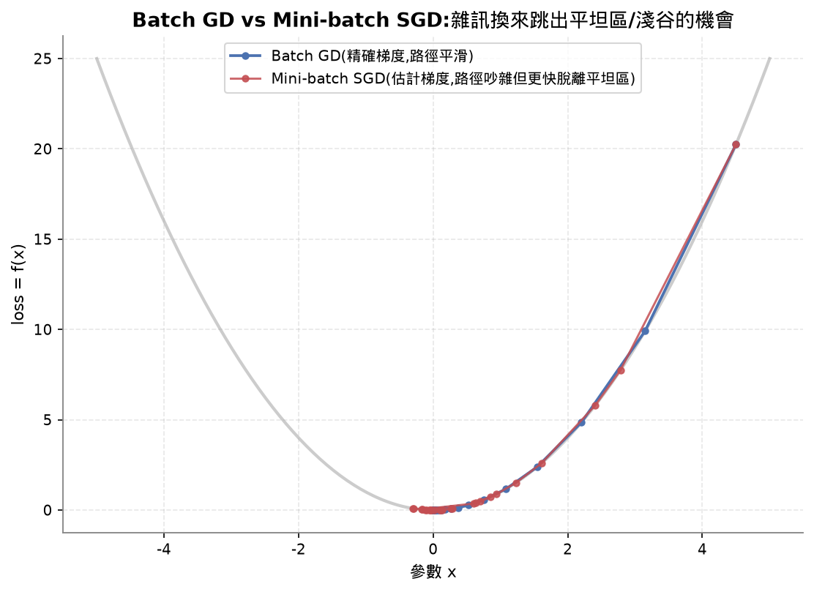
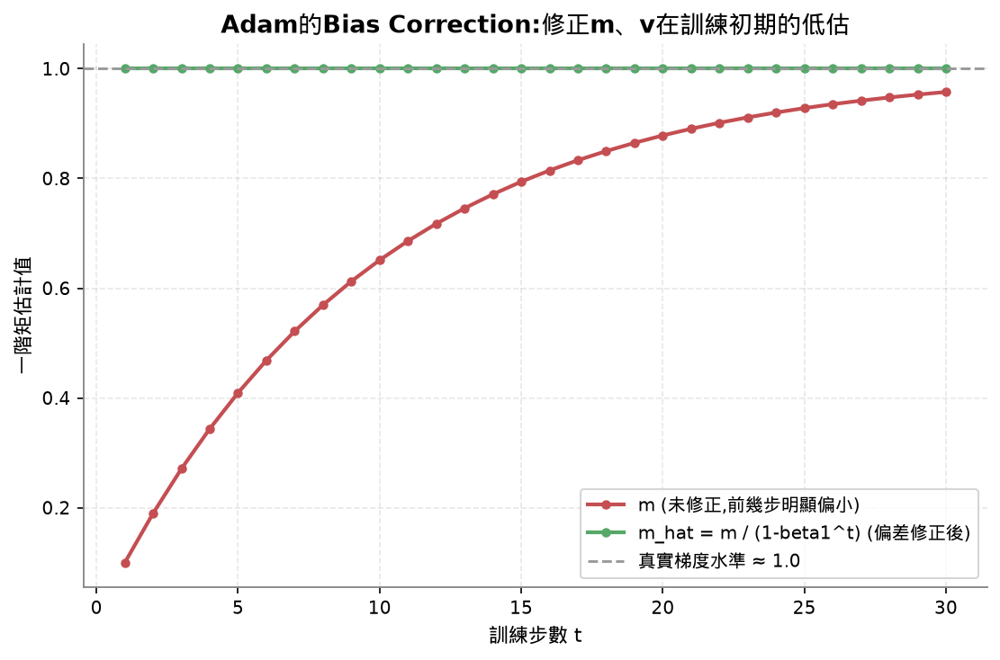

# Optimization

學習機器學習的核心最佳化演算法。掌握梯度下降、動量機制（Momentum）與自適應學習率（Adam），並理解非凸損失地形中的鞍點特性與學習率排程。

## 名詞
| 名詞 | 意思 |
|---|---|
| Gradient descent（梯度下降） | 沿著梯度反方向更新權重,最基本的最佳化方法 |
| Learning rate（學習率） | 控制每次更新走多大步的數字 |
| Momentum（動量） | 把過去的梯度累積成速度,減少震盪、加速收斂 |
| SGD（隨機梯度下降） | 用一小批資料(不是全部)估計梯度就更新,比較快但比較吵 |
| Mini-batch（小批次） | 一次拿32~256筆資料算梯度,速度跟準確度的折衷 |
| Adam（—） | 幫每個權重自動調整專屬學習率的最佳化方法 |
| Bias correction（偏差修正） | Adam因為初始值是0,前幾步會偏小,除以修正項補回來 |
| Learning rate schedule（學習率排程） | 訓練過程中動態調整學習率(前面大步,後面小步) |
| Convex function（凸函數） | 沒有壞的局部最小值,每個局部最小值都是全域最小值;平滑的凸函數只要學習率夠小,梯度下降一定會收斂到最小值 |
| Saddle point（鞍點） | 梯度是0,但某些方向是最小值、某些方向是最大值 |
| Loss landscape（損失地形） | 把loss函數畫成地形圖(高原、山谷、鞍點) |
| Convergence（收斂） | 最佳化器走到一個點,之後再更新也不太能再有效降低loss |




## 重點
| 概念 | 我的理解 |
|---|---|
| Gradient Descent | 僅依據當前梯度更新權重，在狹長山谷地形容易出現之字形橫向震盪，收斂緩慢。 |
| Momentum | 累積歷史梯度作為速度向量，互相抵消的震盪被平滑，同方向的推力則加速累積，幫助越過平坦區與淺凹凸。 |
| Adam | 結合動量（一階矩）與自適應學習率（二階矩）。梯度大的權重步伐自動縮小，梯度小的權重步伐自動放大，並附帶偏差修正。 |
| Saddle Point | 高維度非凸地形中，所有方向都是極小值的機率極低，鞍點（部分方向上凸、部分方向下凹）遠比局部極小值更常見。 |
| LR Schedule | 動態調整步長。常見有 Cosine Annealing（前期大步探測、後期平滑精修）與 Warmup（前期緩慢拉升防止梯度發散）。 |

## 公式／程式
```text
梯度下降: w = w - lr * grad
Momentum: v = β * v + grad; w = w - lr * v
Adam 一階矩 (方向): m = β1 * m + (1 - β1) * grad
Adam 二階矩 (規模): v = β2 * v + (1 - β2) * grad²
Adam 偏差修正: m_hat = m / (1 - β1^t), v_hat = v / (1 - β2^t)
Adam 更新: w = w - lr * m_hat / (sqrt(v_hat) + ε)
```

```python
# Adam 單步更新邏輯
m = beta1 * m + (1 - beta1) * grad
v = beta2 * v + (1 - beta2) * (grad ** 2)
m_hat = m / (1 - beta1 ** t)
v_hat = v / (1 - beta2 ** t)
w -= lr * m_hat / (math.sqrt(v_hat) + eps)
```

## 卡住的地方
- 容易誤以為神經網路訓練停滯主要是掉入局部極小值；實際上在高維空間中，所有維度同時呈現谷底的機率極小，絕大多數停滯是由鞍點和平坦區造成。
- 誤以為 Adam 一定在所有任務上勝過 SGD；實務上 Adam 收斂快且調參容忍度高，但經精細調參的 SGD with Momentum 在部分視覺任務上的泛化性能往往更優。
- Adam 在訓練初期由於 m 與 v 初始化為 0 會嚴重低估，必須除以 `(1 - β^t)` 進行偏差修正。
