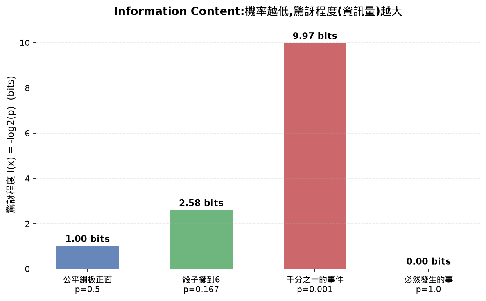
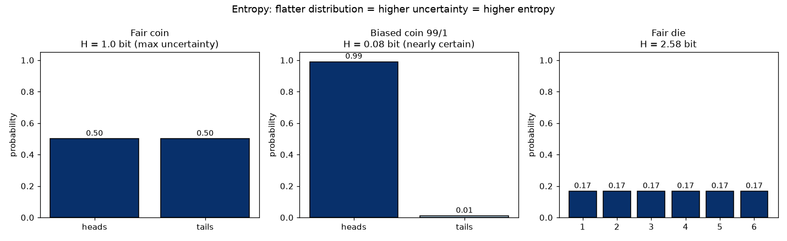

# Information Theory

學習資訊理論核心概念及其在機器學習損失函數中的理論根基。掌握資訊量、熵、交叉熵、KL 散度、互資訊與困惑度（Perplexity）的關係。

## 名詞
| 名詞 | 意思 |
|---|---|
| Information content（資訊量/驚訝程度） | 單一事件的驚訝程度:-log(p(x)) |
| Entropy（熵） | 整個分布的平均驚訝程度，就是不確定性本身，也是平均編碼長度的下限 |
| Cross-entropy（交叉熵） | 用模型猜的Q去描述真實分布P，平均要花多少bit(=分類loss) |
| KL divergence（KL散度） | 用Q取代P多浪費的bit數，不對稱，不是真正的距離 |
| Mutual information（互資訊） | 知道一個變數，能讓你對另一個變數的不確定性減少多少 |
| One-hot（獨熱編碼） | 正確答案位置是1，其他全部是0的向量表示法 |
| Perplexity（困惑度） | 交叉熵取指數，模型平均像在幾個選項間猶豫 |
| Softmax | 把任意實數向量轉成合法機率分布(總和=1) |
| Negative log-likelihood（負對數概似） | 跟cross-entropy loss數學上完全相同 |
| Bits / Nats | log base 2 / log base e 的單位差別，PyTorch預設用nats |




## 重點
| 概念 | 我的理解 |
|---|---|
| Information Content | 單一事件的驚訝程度，定義為 `-log(p)`。發生機率越低的事件，發生時帶來的資訊量越大。 |
| Entropy | 整個分布的平均驚訝程度，代表分布本身的不確定性，也是平均編碼長度的下限，分布越均勻熵越高。 |
| Cross-Entropy | 用模型分布 Q 去逼近真實分布 P 時平均所需的編碼長度，即神經網路分類任務常用的損失函數。 |
| KL Divergence | `D_KL(P \|\| Q) = H(P, Q) - H(P)`，代表用 Q 取代 P 所額外浪費的成本。KL 散度不具對稱性，不是嚴格的幾何距離。 |
| Mutual Information | 衡量兩個變數共享的資訊量，能捕捉非線性關聯，比僅限線性關係的 Pearson 相關係數更具表達力。 |

## 公式／程式
```text
資訊量: I(x) = -log(p(x))
熵: H(P) = -Σ p(x) * log(p(x))
交叉熵: H(P, Q) = -Σ p(x) * log(q(x)) = H(P) + D_KL(P || Q)
One-hot 簡化交叉熵: H(P, Q) = -log(q(true_class))
困惑度: Perplexity = exp(Cross-Entropy)
互資訊: I(X; Y) = H(X) - H(X|Y)
```

```python
# 熵與交叉熵計算
def entropy(p):
    return -sum(pi * math.log(pi) for pi in p if pi > 0)

def cross_entropy(p, q):
    return -sum(pi * math.log(qi) for pi, qi in zip(p, q) if pi > 0)
```

## 卡住的地方
- 容易把 Pearson 相關係數（衡量兩變數線性關聯）與 Poisson 分布（描述事件發生次數的機率分布）混淆。
- 一開始不清楚為何交叉熵常被簡化為單項 `-log(q_true)`；原因在於分類標籤是 one-hot 向量，其他類別的真實機率為 0，在加總中直接消失。
- 容易誤認 KL 散度為對稱距離，實際上 `D_KL(P || Q) != D_KL(Q || P)`，方向不同代表懲罰過度自信或遺漏模式的代價不同。
