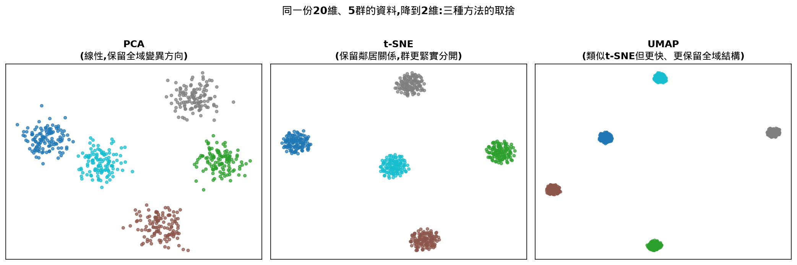
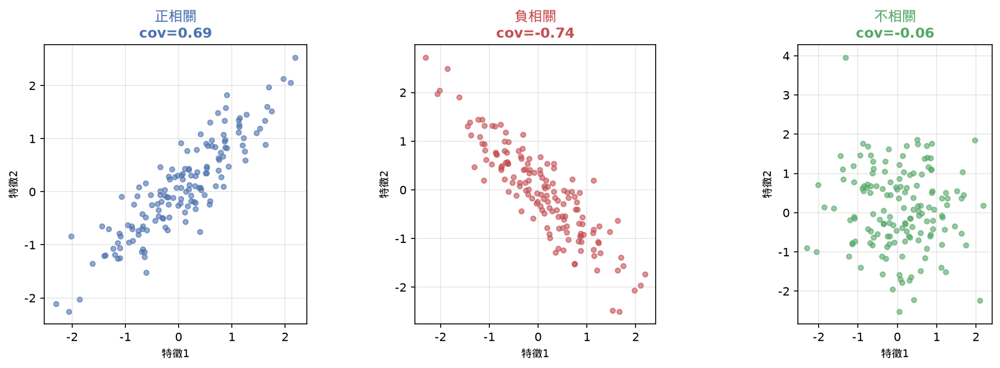

# Dimensionality Reduction

學習特徵降維與資料壓縮技術。掌握主成分分析（PCA）的五大步驟、解釋變異比（Explained Variance Ratio）、維度詛咒（Curse of Dimensionality）與 Kernel PCA 非線性降維。

## 名詞
| 名詞 | 意思 |
|---|---|
| Dimensionality reduction（降維） | 把高維資料壓縮成低維,同時盡量保留有用資訊 |
| Curse of dimensionality（維度詛咒） | 維度越高,資料點之間的距離越趨於相同,「近」失去意義 |
| PCA (Principal Component Analysis)（主成分分析） | 找出資料變異最大的方向,依變異量排序,只留前k個方向 |
| Eigenvector / Eigenvalue（特徵向量/特徵值） | 特徵向量是矩陣變換後方向不變的特殊方向,特徵值是那個方向被拉長/壓縮的倍數;PCA裡特徵向量=變異方向,特徵值=那個方向的變異量大小 |
| Covariance（共變異數） | 量化兩個特徵是不是傾向一起變大變小(正相關)、一個大一個小(負相關),還是無關(接近0) |
| Covariance matrix（共變異數矩陣） | 每對特徵之間共變異數排成的表格,一定是對稱矩陣(cov(i,j)=cov(j,i)),對角線是各特徵自己的變異數 |
| Explained variance ratio（解釋變異比例） | 每個主成分佔總變異量的比例,判斷保留k個維度夠不夠 |
| Reconstruction error（還原誤差） | 降維後再還原回原始維度,跟原始資料差多少(MSE) |
| Kernel trick（核技巧） | 不用真的算出高維座標,只算兩兩資料點的相似度(核矩陣)就能做到等效的高維運算 |
| Kernel PCA（核PCA） | 用kernel trick在隱含的高維空間做PCA,能處理非線性資料(如同心圓) |
| t-SNE（—） | 保留「鄰居關係」的非線性降維法,常用來畫圖視覺化,有perplexity參數(跟Lesson 9的困惑度只是同名,概念不同) |
| UMAP（—） | 類似t-SNE但更快、更保留全域結構,常用n_neighbors/min_dist |
| Manifold（流形） | 嵌在高維空間裡的低維曲面,例如一張紙揉皺後丟進3D空間,本質還是一個2D曲面 |




## 重點
| 概念 | 我的理解 |
|---|---|
| PCA Pipeline | 資料置中 -> 計算共變異數矩陣 -> 特徵分解（eigh） -> 特徵值由大到小排序 -> 取前 k 個特徵向量作為投影矩陣。 |
| Explained Variance Ratio | 每個主成分特徵值除以所有特徵值總和，代表該主成分抓住的變異比例。加總即為保留的總變異量。 |
| Curse of Dimensionality | 隨著維度升高，任意兩點間的距離趨於均等，近鄰與遠鄰的相對差距消失，依賴距離的演算法（如 KNN）會因而失效。 |
| Kernel PCA | 利用 Kernel Trick（如 RBF 核）計算樣本間相似度矩陣取代共變異數矩陣，無需顯式升維即可分離同心圓等非線性結構。 |
| Reconstruction Error | 降維資料反向重構回原始維度時的均方誤差（MSE），開根號後即為 RMSE，量化降維造成的資訊損失。 |

## 公式／程式
```text
共變異數矩陣: Cov(X) = (X - μ)^T @ (X - μ) / (n - 1)
解釋變異比例: ratio_i = λ_i / Σ λ_j
投影降維: X_proj = (X - μ) @ W_k
RBF 核函數: K(x, y) = exp(-γ * ||x - y||²)
重構誤差 (MSE): mean((X - X_reconstructed)²)
```

```python
# PCA fit 核心邏輯
self.mean = np.mean(X, axis=0)
X_centered = X - self.mean
cov_matrix = np.cov(X_centered, rowvar=False)
eigenvalues, eigenvectors = np.linalg.eigh(cov_matrix)
sorted_idx = np.argsort(eigenvalues)[::-1]
self.components = eigenvectors[:, sorted_idx[:n_components]]
```

## 卡住的地方
- 一開始困惑應保留變異量大還是小的方向；其實變異量大的方向才是資料主要的變動訊號，變異量接近 0 的方向多為冗餘或雜訊。
- `transform` 新資料時必須沿用 `fit` 存下的訓練集均值進行置中，若誤用新資料自身的均值會造成座標原點不一致而使方向對齊失效。
- 還原誤差不能直接相減平均，否則正負誤差會互相抵消造成誤差極小的假象，必須取平方（MSE）或進一步開根號（RMSE）。
