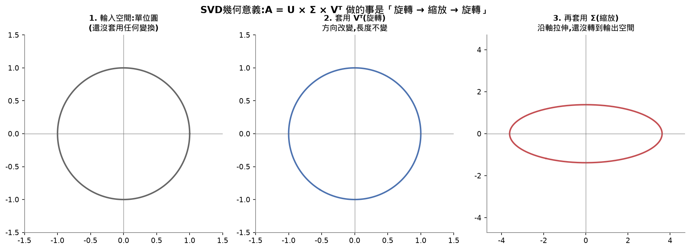
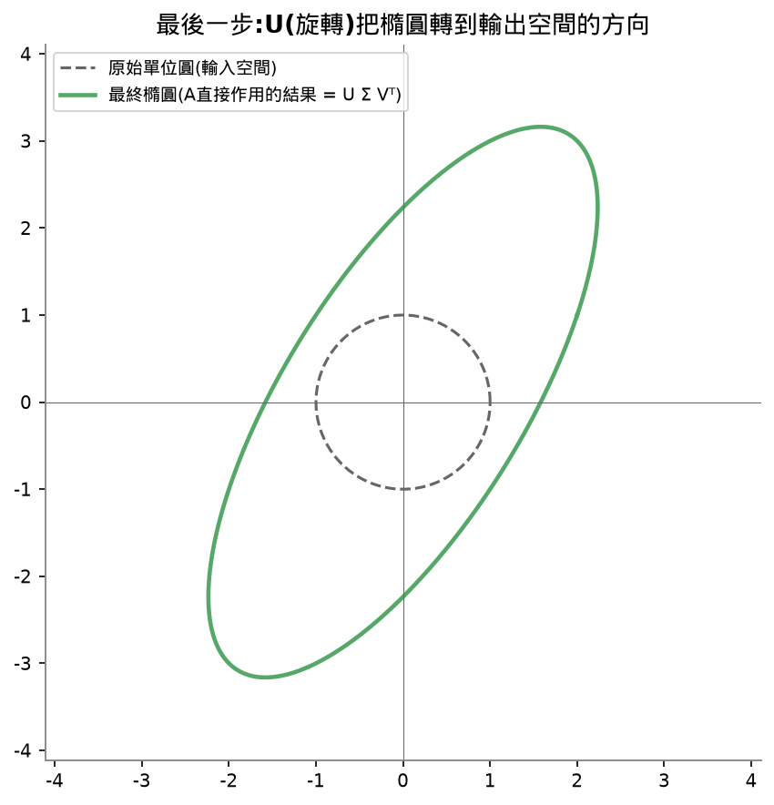

# Singular Value Decomposition

學習奇異值分解（SVD）。將任意形狀矩陣拆解為旋轉、縮放與旋轉三個步驟，理解截斷 SVD 低秩近似、冪迭代法（Power Iteration）與 PCA 的本質關聯。

## 名詞
| 名詞 | 意思 |
|---|---|
| SVD (Singular Value Decomposition)（奇異值分解） | 把任何形狀、任何矩陣拆成 `U × Σ × Vᵀ`，沒有條件限制 |
| Singular value（奇異值） | Σ對角線上的數字，代表矩陣沿某方向拉伸/壓縮的倍數，非負、由大到小排序 |
| Left singular vector（左奇異向量） | U的每一欄，輸出空間的方向 |
| Right singular vector（右奇異向量） | V的每一欄，輸入空間的方向 |
| Truncated SVD（截斷SVD） | 只留前k個奇異值/向量，數學上證明過的最佳rank-k近似 |
| Rank（秩） | 非零奇異值的個數，矩陣真正用到的獨立方向數量 |
| Pseudoinverse（偽逆矩陣） | `A⁺ = V Σ⁺ Uᵀ`，對任何矩陣都能算，解最小平方法問題 |
| Condition number（條件數） | `σ_max/σ_min`，越大代表對誤差越敏感 |
| Latent factor（潛在因子） | SVD找出的低維空間裡的隱藏變數，例如推薦系統裡的類型偏好 |
| Frobenius norm（Frobenius範數） | 矩陣所有元素平方和開根號，等於所有奇異值平方和開根號 |
| Eckart-Young theorem（Eckart-Young定理） | 截斷SVD是給定rank-k裡誤差最小的近似，證明過的最佳解 |
| Power iteration（冪迭代法） | 反覆乘矩陣+normalize，收斂到最大特徵值方向 |
| Orthogonal matrix（正交矩陣） | 每一欄互相垂直、長度都是1的矩陣;乘上它只旋轉，長度不變 |
| Outer product（外積） | 兩個向量相乘變成一個矩陣(跟內積相反，內積是變成一個數字) |
| Deflation（降階/扣除） | 找到一個主要方向後從矩陣扣掉，讓下一輪找到次要方向 |
| Residual（殘餘矩陣） | 還沒被目前找到的方向解釋掉的剩餘部分 |
| Eigenvector（特徵向量） | 被矩陣乘完只變長或變短、方向不變的特殊方向，倍數叫特徵值(Eigenvalue) |
| Main diagonal（主對角線） | 矩陣從左上到右下那條斜線，奇異值就放在Σ的主對角線上 |
| Diagonal matrix（對角矩陣） | 只有主對角線有數字、其他位置全是0的矩陣，效果是各方向各自縮放、互不影響 |
| Trace（跡） | 主對角線上的數字加總，寫成tr(A) |
| Norm（範數） | 「長度/大小」的正式數學名稱，預設(L2 norm)就是Lesson 1的向量長度 |




## 重點
| 概念 | 我的理解 |
|---|---|
| SVD 幾何意義 | 任何矩陣皆可分解為 `A = U @ Σ @ V^T`。V^T 是輸入空間的正交旋轉，Σ 是沿各軸縮放，U 是輸出空間的正交旋轉。 |
| Singular Values | Σ 主對角線上的奇異值由大到小排列，代表各獨立方向的拉伸程度與重要性權重。 |
| Truncated SVD | 根據 Eckart-Young 定理，只保留前 k 個最大奇異值與對應奇異向量的重構矩陣，是數學上最佳的 rank-k 低秩近似。 |
| Power Iteration | 反覆執行「矩陣相乘並正規化」，因為最大特徵值方向每輪放大倍率最高，向量最終會收斂至主成分方向。 |
| Pseudoinverse | 偽逆矩陣公式為 `A^+ = V @ Σ^+ @ U^T`（Σ^+ 為非零奇異值取倒數），適用於求解無精確解的超定系統最小平方法。 |

## 公式／程式
```text
SVD 分解: A = U @ Σ @ V^T
外積形式: A = Σ σ_i * (u_i @ v_i^T)
截斷 SVD: A_k = U[:, :k] @ diag(σ[:k]) @ V^T[:k, :]
偽逆矩陣: A^+ = V @ Σ^+ @ U^T
A^T @ A 與 SVD 關係: A^T @ A = V @ Σ² @ V^T
```

```python
# Power Iteration 核心片段
v = np.random.randn(M.shape[1])
v /= np.linalg.norm(v)
for _ in range(num_iters):
    v = M @ v
    v /= np.linalg.norm(v)
eigenvalue = v @ M @ v
```

## 卡住的地方
- `np.linalg.svd()` 回傳的第三個陣列是 `Vt`（已轉置的 V^T），若後續公式需要右奇異向量 V，必須主動使用 `Vt.T` 轉回。
- 截斷 SVD 的壓縮效果取決於奇異值衰減速度；純隨機雜訊矩陣的奇異值分布平緩，若強行低秩近似會產生極大誤差。
- 以為 PCA 必須先乘出 `A^T @ A` 再做特徵分解；實際上直接對資料矩陣做 SVD 更穩定，可避免條件數平方造成的數值精度流失。
