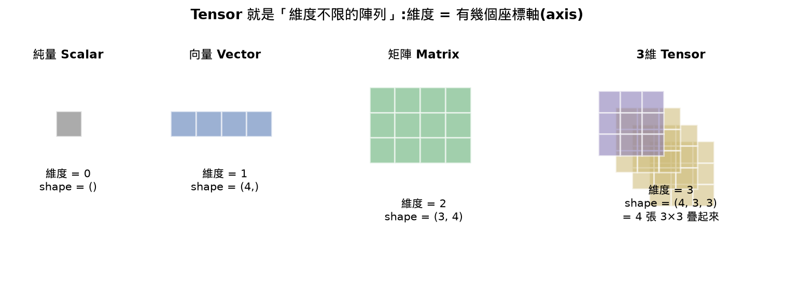
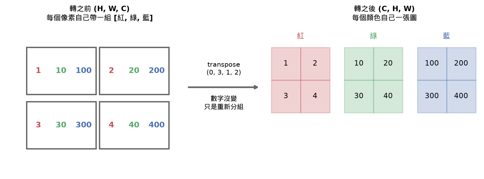

# Tensor Operations

學習多維張量結構與記憶體佈局。掌握形狀變換（reshape、transpose）、步幅（stride）、連續性（contiguous）、廣播機制與 einsum 愛因斯坦求和標記。

## 名詞
| 名詞 | 意思 |
|---|---|
| Tensor（張量） | 維度不限、資料型態一致的陣列，有shape、strides和運算 |
| Rank（階/維度數） | 有幾個座標軸;注意跟Lesson 11「矩陣的秩」是兩回事 |
| Axis（軸） | 其中一個座標軸，從第0軸開始編號 |
| Shape（形狀） | 每個軸的大小組成的tuple,`(2,3)`是2列3欄 |
| Stride（步幅） | 在記憶體裡沿某個軸走一步要跳過幾個元素 |
| Broadcasting（廣播） | shape不同的tensor運算時，自動把大小為1的軸拉大去對齊;規則嚴格，對不齊就報錯 |
| Contiguous（連續） | 元素在記憶體裡照邏輯順序依序排，沒有跳來跳去 |
| View（視圖） | 同一塊記憶體、不同的shape/stride看法;對non-contiguous的tensor會失敗 |
| Einsum（愛因斯坦求和） | 用字母替每個軸命名，一行寫出內積、矩陣乘法、外積、轉置等運算 |
| Contraction（縮併） | 兩個tensor共用的軸被相乘再加總掉，結果維度變低 |
| NCHW / NHWC（圖片軸順序） | 通道在前(PyTorch)或在後(TensorFlow)的排法 |
| Squeeze / Unsqueeze（壓縮/展開軸） | 移除或插入一個大小為1的軸，元素不變 |
| Permute（重排軸） | 一次重新排列所有軸的順序;transpose是只交換兩個軸的特例 |
| Reduction（歸約） | sum、mean、max等把一個或多個軸「收掉」的運算 |
| Main diagonal / Trace（主對角線/跡） | (Lesson 11複習時補的)跡是主對角線的加總 |




## 重點
| 概念 | 我的理解 |
|---|---|
| Stride & Contiguity | 記憶體是一維平坦陣列，stride 代表沿某軸移動一步需跨越的元素個數。transpose 只對調 stride、不搬移資料(只是改變邏輯上的索引順序)，但會使張量變為 non-contiguous。 |
| Reshape vs Transpose | reshape 改變檢視維度切法但元素總數不變，`-1` 由系統推算；transpose 重新排列軸的順序，邏輯索引順序改變，記憶體裡的資料沒有被搬動。 |
| Broadcasting | 左側自動補 1 後由右至左比對，各軸大小必須相等或其中一方為 1 才能自動沿該軸複製對齊，否則引發形狀錯誤。 |
| View vs Reshape | PyTorch 的 `view` 要求張量在記憶體中連續；non-contiguous 張量需先呼叫 `.contiguous()` 或直接使用 `reshape`。 |
| Einsum | 依字母指定各軸名稱，箭頭左側出現但右側消失的字母即為相乘後加總消去的軸（縮併）。 |

## 公式／程式
```text
外積廣播: a.reshape(-1, 1) * b.reshape(1, -1) -> 形狀 (n, m)
軸轉置 (NHWC -> NCHW): x.transpose(0, 3, 1, 2)
內積 einsum: np.einsum("i,i->", a, b)
矩陣乘法 einsum: np.einsum("ik,kj->ij", A, B)
注意力分數 einsum: np.einsum("bhtd,bhsd->bhts", Q, K)
```

```python
# 廣播外積範例
a = np.array([1, 2, 3]).reshape(-1, 1)      # shape (3, 1)
b = np.array([10, 20, 30, 40]).reshape(1, -1)  # shape (1, 4)
outer_product = a * b                      # shape (3, 4)
```

## 卡住的地方
- `transpose` 括號內的軸編號容易搞反方向；正確記憶法是括號裡的順序代表「新的第 0、1、2、3 軸依序由舊的第幾軸填入」。
- 當兩個維度大小相同（如 28x28 影像的高與寬），軸轉置後 shape 數值完全一樣，容易讓人誤以為資料沒變，實際上內容已被對角翻轉。
- transpose 後張量變為 non-contiguous，呼叫 PyTorch `view()` 會拋出錯誤，必須先做 `.contiguous()` 或使用 `reshape()`。
