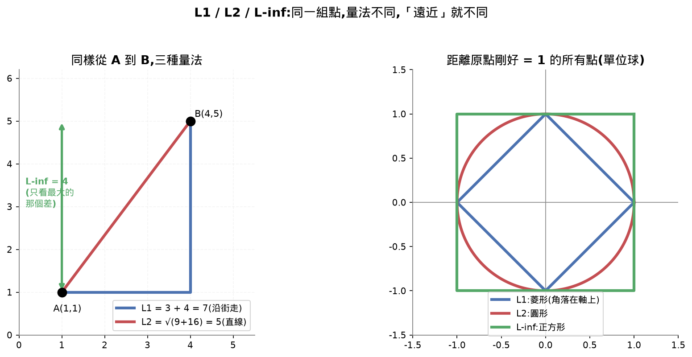
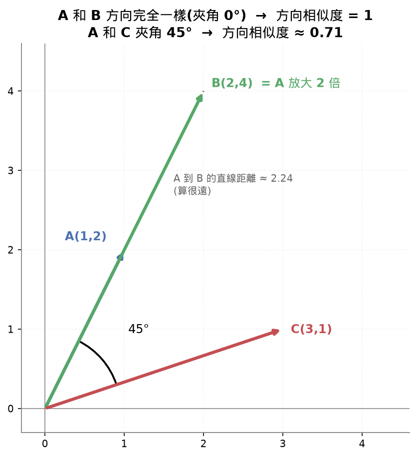

# Norms and Distances

學習各類範數與距離度量方式及其在模型訓練中的角色。掌握 L1、L2、L∞、Cosine、Mahalanobis、Jaccard、編輯距離、搬土距離，以及正則化與損失函數的關聯。

## 名詞
| 名詞 | 意思 |
|---|---|
| Norm（範數） | 量一個向量「有多長」的方法 |
| L1 norm(Manhattan distance)（L1範數(走格子距離)） | 每個分量取絕對值再相加，像在棋盤式街道只能沿街走 |
| L2 norm(Euclidean distance)（L2範數(直線距離)） | 各分量平方相加再開根號，就是兩點間的直線 |
| Lp norm（Lp範數） | L1、L2的一般化，每個分量取p次方再開p次方根 |
| L-infinity norm(Chebyshev distance)（L∞範數(最大差)） | 只看差最大的那一個分量，是p趨近無限大時Lp的極限 |
| Cosine similarity（cosine相似度） | 內積除以兩個長度，只看夾角、不看長度，範圍−1到1 |
| Cosine distance（cosine距離） | 1減cosine相似度，把「越像越大」翻成「越像越小」 |
| Dot product（內積） | 對應位置相乘再相加，同時包含方向和長度 |
| Mahalanobis distance（Mahalanobis距離） | 會看資料形狀(相關性和尺度)的距離，等距離線是橢圓 |
| Jaccard similarity（Jaccard相似度） | 兩個集合的交集大小除以聯集大小 |
| Edit distance(Levenshtein)（編輯距離） | 把一個字串變成另一個，最少需要的插入、刪除、替換次數 |
| KL divergence（KL散度） | 真實是P、你以為是Q，平均會多損失多少資訊;不對稱，所以不算真正的距離 |
| Wasserstein distance(Earth Mover's)（搬土距離） | 把一個分布當土堆搬成另一個分布要花的工(土量×距離)，是真正的距離 |
| Approximate nearest neighbor(ANN)（近似最近鄰） | 犧牲一點準確度，換大幅加速的最近鄰搜尋 |
| HNSW（多層近鄰圖） | 向量資料庫最常用的ANN演算法，多層圖，上層稀疏長跳、下層密集短跳 |
| L1 regularization(Lasso)（L1正則化） | 損失加上權重的L1範數，讓小權重剛好歸0，自動選特徵 |
| L2 regularization(Ridge、weight decay)（L2正則化） | 損失加上權重的L2平方，所有權重一起縮小但不歸0 |
| Elastic Net（彈性網路） | L1加L2一起用 |
| Normalization（正規化） | 縮放資料，例如縮成長度1 |
| Standardization（標準化） | 減平均再除以標準差，變成平均0、標準差1 |
| Regularization（正則化） | 在損失裡加處罰，限制模型權重大小，防止死背 |
| MAE（平均絕對誤差） | 誤差取絕對值再平均，是L1做的損失 |
| MSE（平均平方誤差） | 誤差平方再平均，是L2平方做的損失 |
| Huber loss（Huber損失） | 小誤差用L2、大誤差用L1的折衷 |
| Correlation（相關） | 兩個特徵會一起變大或變小，畫成圖是斜斜一長條 |
| Covariance matrix（共變異數矩陣） | 記錄各特徵一起變動的程度(Lesson 10) |
| Cumulative sum（累加） | 從左到右一格一格加起來，第i格是「到這裡為止總共有多少」 |




## 重點
| 概念 | 我的理解 |
|---|---|
| L1, L2, L∞ 範數 | 距離為兩點相減後量的長度。L1 走格子，L2 走直線，L∞ 取各軸最大差值。數值大小恆滿足 `L∞ ≤ L2 ≤ L1`。 |
| Cosine vs 內積 | Cosine 相似度除以長度乘積，只看方向不看尺度（同向 1、垂直 0、反向 -1）；將向量預先正規化為單位長度後，內積即等價於 Cosine。 |
| Mahalanobis Distance | 考量特徵間的相關性與各自尺度（使用共變異數矩陣的逆矩陣），等距線為橢圓而非圓形，常用於多變量異常偵測。 |
| L1 vs L2 正則化 | L1（Lasso）以固定步長衰減使部分小權重剛好歸零產生稀疏解；L2（Ridge）按比例縮小權重，不使權重歸零。 |
| MAE vs MSE | MAE（L1 損失）對離群值較魯棒、最佳解為中位數；MSE（L2 平方損失）對離群值敏感、曲線平滑易最佳化、最佳解為平均數。 |

## 公式／程式
```text
L1 距離 (Manhattan): Σ |a_i - b_i|
L2 距離 (Euclidean): sqrt(Σ (a_i - b_i)²)
L∞ 距離 (Chebyshev): max |a_i - b_i|
Cosine 相似度: cos_sim(a, b) = (a · b) / (||a|| * ||b||)
Cosine 距離: 1 - cos_sim(a, b)
Mahalanobis 距離: sqrt((x - y)^T @ S⁻¹ @ (x - y))
Jaccard 相似度: |A ∩ B| / |A ∪ B|
```

```python
# L1, L2 與 Cosine 距離計算
def l1_distance(a, b):
    return sum(abs(x - y) for x, y in zip(a, b))

def l2_distance(a, b):
    return sum((x - y)**2 for x, y in zip(a, b)) ** 0.5

def cosine_similarity(a, b):
    dot = sum(x * y for x, y in zip(a, b))
    norm_a = sum(x**2 for x in a) ** 0.5
    norm_b = sum(y**2 for y in b) ** 0.5
    return dot / (norm_a * norm_b)
```

## 卡住的地方
- 容易誤將 L∞ 記成「取最小差值」；實際上 L∞ 是 Lp 範數當 p 趨於無窮大時的極限，其數值必定等於各座標差值中「絕對值最大」的那一個。
- 混淆「正規化（縮放資料至指定尺度）」、「標準化（平移縮放使均值 0 標準差 1）」與「正則化（在損失函數中加入權重懲罰項）」，三者概念與操作對象完全不同。
- 計算編輯距離動態規劃表格時，一開始誤將欄位看成單個字母而困惑空字串變換成本；其實表格每個單元格代表的是「前綴子字串」變換的最少操作次數。
